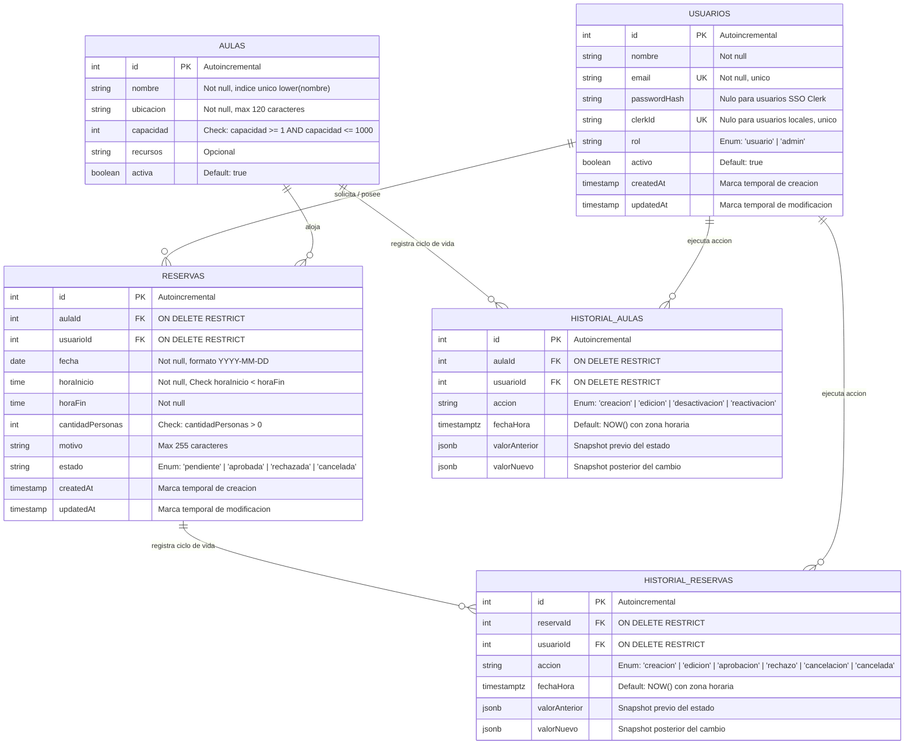
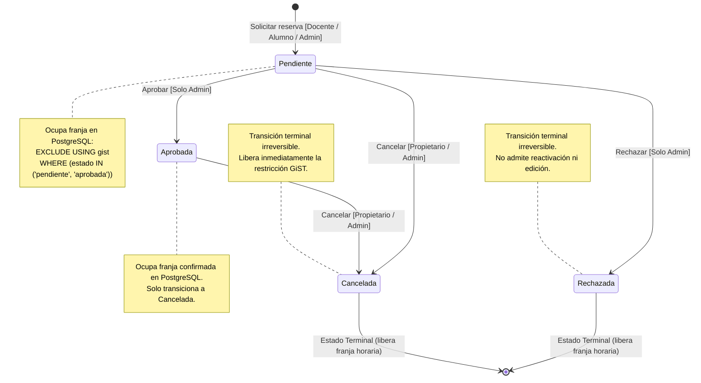

# Arquitectura Técnica — Sistema de Reservas de Aulas

Este documento describe la arquitectura técnica, modelo de datos, reglas de negocio y diseño de endpoints del sistema de reservas de aulas, orientado a la evaluación técnica del proyecto.

---

## 1. Visión General de la Arquitectura

El sistema está diseñado bajo una arquitectura multicapa desacoplada y contenerizada:

- **Frontend SPA:** Desarrollado en React 19 con Vite, modularizado mediante CSS Modules y tokens CSS (`tokens.css`). Implementa autenticación híbrida (Clerk y JWT local) y comunicación REST mediante Axios con interceptores de autorización.
- **Reverse Proxy y Servidor Web:** Nginx 1.27 en contenedor Alpine, encargado del servicio de estáticos, terminación de proxy hacia la API backend y endurecimiento de cabeceras HTTP con una Content-Security-Policy (CSP) estricta.
- **Backend API:** Servidor Node.js (ESM) con Express, ORM Sequelize 6 y validación de esquemas Zod en middleware. Todas las operaciones críticas de escritura se ejecutan dentro de transacciones de base de datos gestionadas.
- **Motor de Base de Datos:** PostgreSQL 16 con extensión `btree_gist`, configurado con restricciones de integridad referencial, checks y una restricción de exclusión a nivel de motor contra solapamientos horarios.

---

## 2. Estructura del Repositorio

```
reservas/
├── .github/
│   ├── dependabot.yml           # Configuración de actualización mensual de dependencias
│   └── workflows/
│       ├── ci.yml               # Pipeline de integración continua (tests, lint, trivy, semgrep, gitleaks)
│       └── codeql.yml           # Análisis estático de seguridad SAST con CodeQL
├── docker/
│   └── postgres/
│       └── init-test-db.sql     # Script de inicialización de la base de datos de pruebas
├── docker-compose.yml           # Infraestructura PostgreSQL 16 para desarrollo
├── docker-compose.prod.yml      # Entorno de despliegue completo de producción
├── docs/                        # Documentación técnica (Arquitectura, Seguridad, Diseño, Calidad…)
│   ├── ARQUITECTURA.md
│   ├── CALIDAD.md
│   ├── DEPLOY.md
│   ├── DISENO.md
│   ├── RENDIMIENTO.md
│   ├── SEGURIDAD.md
│   ├── adr/                     # Decisiones de arquitectura, una por archivo
│   ├── img/                     # Capturas generadas por `npm run capturas --prefix e2e`
│   └── seguridad/evidencia/     # Reportes y logs de auditorías de seguridad
├── backend/
│   ├── index.js                 # Punto de entrada del servidor API
│   ├── db/
│   │   ├── config.cjs           # Configuración de conexiones por entorno
│   │   ├── migrations/          # Migraciones versionadas de esquema PostgreSQL
│   │   └── seeders/             # Semillero de datos de demostración
│   ├── src/
│   │   ├── app.js               # Configuración de Express, middlewares y rutas
│   │   ├── config/              # Variables de entorno y cliente Sequelize
│   │   ├── controllers/         # Controladores de peticiones HTTP
│   │   ├── middleware/          # Autenticación, validación Zod, rate limiting y manejo de errores
│   │   ├── models/              # Definición de modelos Sequelize y asociaciones
│   │   ├── routes/              # Definición de rutas y mapeo de endpoints
│   │   ├── services/            # Lógica de negocio y transacciones de base de datos
│   │   └── utils/               # Utilidades de cálculo horario en zona horaria local
│   └── tests/                   # Pruebas unitarias, de integración, contrato y concurrencia
├── frontend/
│   ├── Dockerfile               # Compilación multi-etapa (Node → Nginx Alpine)
│   ├── nginx.conf               # Servidor web de producción y proxy API
│   ├── public/
│   │   └── tema-init.js         # Script estático de inicialización de tema anti-flicker
│   ├── scripts/
│   │   └── verificar-contraste.js # Validación de contrastes WCAG 2.1 AA en tokens CSS
│   └── src/
│       ├── components/          # Componentes de layout, grilla interactiva y vistas de reservas
│       ├── context/             # Contexto de autenticación y sesión
│       ├── hooks/               # Custom hooks (tema, OAuth, trampa de foco, navegación de grilla)
│       ├── pages/               # Páginas de la aplicación (Reservas, Formulario, Panel, Login)
│       ├── services/            # Clientes de servicios API con Axios
│       └── styles/              # Variables tokens.css y reset base.css
├── e2e/                         # Pruebas de extremo a extremo y generación de capturas
│   ├── capturas/                # Genera docs/img y el GIF desde la aplicación real
│   ├── soporte/                 # Entorno compartido, ayudas y diagnóstico de fallos
│   └── tests/                   # Los 7 flujos completos de usuario
└── carga/                       # Pruebas de carga con k6 (manuales)
```

---

## 3. Modelo de Datos y Restricciones de PostgreSQL

El esquema de base de datos se administra mediante migraciones versionadas con Sequelize CLI.

### 3.1. Diagrama Entidad-Relación (DER)

El siguiente diagrama formaliza el modelo relacional del sistema en tercera forma normal (3FN), detallando claves primarias, foráneas, tipos y restricciones de integridad:



### 3.2. Entidades Principales y Restricciones

- **`usuarios`:** Gestiona cuentas locales y vinculación JIT con Clerk.
  - `id`: Entero, clave primaria autoincremental.
  - `nombre`, `email` (único), `passwordHash` (nulo para usuarios SSO Clerk), `clerkId` (único, nulo para locales), `rol` (`'usuario'` o `'admin'`), `activo` (booleano).
- **`aulas`:** Aulas disponibles para asignación.
  - `id`: Entero, clave primaria.
  - `nombre`: Cadena de texto obligatoria con índice único insensible a mayúsculas (`LOWER(nombre)`).
  - `ubicacion`: Cadena de texto obligatoria (máx. 120 caracteres).
  - `capacidad`: Entero (check `capacidad >= 1 AND capacidad <= 1000`).
  - `recursos`: Cadena de texto opcional.
  - `activa`: Booleano (default: `true`).
- **`reservas`:** Solicitudes y reservas asignadas.
  - `id`: Entero, clave primaria.
  - `aulaId`: FK hacia `aulas.id` (`ON DELETE RESTRICT`).
  - `usuarioId`: FK hacia `usuarios.id` (`ON DELETE RESTRICT`).
  - `fecha`: `DATE` (`YYYY-MM-DD`).
  - `horaInicio`, `horaFin`: `TIME` (check `horaInicio < horaFin`).
  - `cantidadPersonas`: Entero (check `cantidadPersonas > 0`).
  - `motivo`: Cadena de texto (máx. 255 caracteres).
  - `estado`: Enum textual (`'pendiente'`, `'aprobada'`, `'rechazada'`, `'cancelada'`).
- **`historial_reservas`:** Registro append-only inmutable de trazabilidad y auditoría cronológica de reservas. Protegido por el disparador `trg_historial_reservas_inmutable`, que rechaza `UPDATE` y `DELETE` (migración `005`).
  - `id`: Entero, clave primaria.
  - `reservaId`: FK hacia `reservas.id` (`ON DELETE RESTRICT`).
  - `usuarioId`: FK hacia `usuarios.id` (`ON DELETE RESTRICT`).
  - `accion`: Enum textual (`'creacion'`, `'edicion'`, `'aprobacion'`, `'rechazo'`, `'cancelacion'`, `'cancelada'`).
  - `fechaHora`: Marca temporal con zona horaria (`TIMESTAMPTZ`).
  - `valorAnterior`, `valorNuevo`: Campos `JSONB` que preservan el estado del cambio.
- **`historial_aulas`:** Registro append-only inmutable de trazabilidad del ciclo de vida de aulas.
  - `id`: Entero, clave primaria autoincremental.
  - `aulaId`: FK hacia `aulas.id` (`ON DELETE RESTRICT`).
  - `usuarioId`: FK hacia `usuarios.id` (`ON DELETE RESTRICT`).
  - `accion`: Enum textual (`'creacion'`, `'edicion'`, `'desactivacion'`, `'reactivacion'`).
  - `fechaHora`: Marca temporal con zona horaria (`TIMESTAMPTZ`).
  - `valorAnterior`, `valorNuevo`: Snapshots `JSONB` antes y después de cada cambio.
  - **Inmutabilidad por Disparador:** Protegida mediante trigger PostgreSQL `trg_historial_aulas_inmutable` que rechaza operaciones `UPDATE` y `DELETE`.

### 3.3. Restricción de Exclusión contra la Doble Reserva (`reservas_sin_solapamiento`)

Para garantizar la inmunidad ante condiciones de carrera (race conditions) en reservas concurrentes, se utiliza la extensión `btree_gist` de PostgreSQL:

```sql
ALTER TABLE reservas ADD CONSTRAINT reservas_sin_solapamiento
EXCLUDE USING gist (
  "aulaId" WITH =,
  tsrange(("fecha" + "horaInicio"), ("fecha" + "horaFin"), '[)') WITH &&
) WHERE (estado IN ('pendiente', 'aprobada'));
```

- **Garantía física:** El motor rechaza físicamente cualquier intento de superposición temporal en la misma aula para reservas activas (`pendiente` o `aprobada`) con el código de error `23P01` (`exclusion_violation`).
- **Intervalo semiabierto `[)`:** Permite reservas consecutivas que comparten el borde exacto (por ejemplo, una reserva de 10:00 a 11:00 y otra de 11:00 a 12:00 en la misma aula).

---

## 4. Endpoints y Control de Acceso (RBAC)

Todos los endpoints bajo `/api/reservas` y `/api/aulas/:id/disponibilidad` requieren cabecera `Authorization: Bearer <token>`.

| Método  | Endpoint                        | Roles Permitidos   | Descripción                                                                                  |
| ------- | ------------------------------- | ------------------ | -------------------------------------------------------------------------------------------- |
| `GET`   | `/api/health`                   | Público            | Estado del servicio y de la base (histórico; equivale a readiness)                           |
| `GET`   | `/api/health/live`              | Público            | Liveness: el proceso responde. No consulta la base de datos                                  |
| `GET`   | `/api/health/ready`             | Público            | Readiness: el servicio puede atender tráfico (verifica la base con límite de 2 s)            |
| `GET`   | `/api/docs/ui`                  | Público (solo dev) | Documentación OpenAPI navegable. No se monta si `NODE_ENV=production`                        |
| `POST`  | `/api/auth/login`               | Público            | Inicio de sesión local con tasa limitada (rate limit)                                        |
| `GET`   | `/api/aulas`                    | Usuario, Admin     | Lista de aulas activas (para admin admite `?incluirInactivas=true` para auditoría y gestión) |
| `POST`  | `/api/aulas`                    | Solo Admin         | Creación de aula con nombre único (case-insensitive), capacidad 1-1000 y auditoría           |
| `PUT`   | `/api/aulas/:id`                | Solo Admin         | Edición integral de aula (valida no reducir capacidad bajo reservas futuras activas -> 409)  |
| `PATCH` | `/api/aulas/:id/desactivar`     | Solo Admin         | Baja lógica de aula; con reservas futuras exige confirmación y las cancela atómicamente      |
| `PATCH` | `/api/aulas/:id/reactivar`      | Solo Admin         | Reactivación de aula inactiva con registro de auditoría                                      |
| `GET`   | `/api/aulas/:id/disponibilidad` | Usuario, Admin     | Franjas horarias ocupadas para una fecha determinada (rechaza 400 si aula inactiva)          |
| `GET`   | `/api/reservas`                 | Usuario, Admin     | Listado paginado y filtrable (usuario ve solo suyas; admin ve todas con solicitante)         |
| `POST`  | `/api/reservas`                 | Usuario, Admin     | Creación de una nueva solicitud de reserva en estado pendiente                               |
| `GET`   | `/api/reservas/:id`             | Propietario, Admin | Detalle completo de una reserva                                                              |
| `GET`   | `/api/reservas/:id/historial`   | Propietario, Admin | Historial de auditoría cronológico del ciclo de vida de la reserva                           |
| `PUT`   | `/api/reservas/:id`             | Solo Admin         | Edición integral de horario, aula, fecha o motivo de una reserva                             |
| `PATCH` | `/api/reservas/:id/aprobar`     | Solo Admin         | Aprobación de una reserva pendiente                                                          |
| `PATCH` | `/api/reservas/:id/rechazar`    | Solo Admin         | Rechazo de una reserva pendiente                                                             |
| `PATCH` | `/api/reservas/:id/cancelar`    | Propietario, Admin | Cancelación de una reserva activa                                                            |
| `GET`   | `/api/reservas/resumen`         | Solo Admin         | Métricas agregadas, solicitudes pendientes de aprobación y reservas del día                  |

---

## 5. Reglas de Negocio e Integridad Transaccional

### 5.1. Reglas de Negocio Principales

1. **Horario Operativo Institucional:** Las reservas deben estar comprendidas estrictamente entre las `08:00` y las `22:00`.
2. **Control Temporal e Intradiario:** No se admiten reservas en fechas pasadas ni en horarios ya transcurridos del día corriente, calculados bajo el huso horario oficial `America/Argentina/Cordoba`.
3. **Capacidad y Estado del Aula:** La cantidad de personas no puede superar la capacidad máxima del aula y el aula debe estar en estado activo (`activa: true`).
4. **Ciclo de Vida de Estados:**
   - De `pendiente` se puede transicionar a `aprobada` (admin), `rechazada` (admin) o `cancelada` (propietario/admin).
   - De `aprobada` solo se puede transicionar a `cancelada` (propietario/admin).
   - Las reservas en estado `rechazada` o `cancelada` son terminales y no pueden modificarse ni reactivarse.
5. **Atomicidad con Transacciones:** Toda modificación de estado o creación de reserva se realiza dentro de transacciones de base de datos (`sequelize.transaction`), asegurando que la escritura en la tabla `reservas` y su registro en `historial_reservas` se completen de manera atómica, aplicando rollback inmediato ante cualquier inconsistencia.

### 5.2. Diagrama de Máquina de Estados (State Machine)

El siguiente diagrama formaliza el ciclo de vida finito de una reserva, indicando roles autorizados y eventos detonantes:



### 5.3. Transiciones Prohibidas e Invariantes Transaccionales

1. **Transiciones Prohibidas:**
   - **`rechazada` o `cancelada` $\rightarrow$ cualquier estado:** Los estados terminales son inmutables. No se permite reabrir, editar ni reactivar una solicitud concluida. Para volver a reservar, se debe generar un nuevo requerimiento.
   - **`aprobada` $\rightarrow$ `pendiente` o `rechazada`:** Una reserva ya confirmada no puede retornar a la cola de evaluación administrativa ni ser rechazada directamente; debe ser cancelada formalmente dejando traza de auditoría.
   - **Edición sobre reservas concluidas:** La operación `PUT /api/reservas/:id` rechaza con error `400 Bad Request` cualquier intento de mutación sobre reservas en estado `rechazada` o `cancelada`.

2. **Invariantes Transaccionales y Motor Relacional:**
   - **Gobernanza y Trazabilidad Inmutable:** Cada transición invoca obligatoriamente `registrarAccion(...)` dentro del mismo bloque `sequelize.transaction`. La operación escribe en `historial_reservas` los snapshots `JSONB` de `valorAnterior` y `valorNuevo`. Si la auditoría fallase por cualquier motivo de persistencia, toda la transacción hace rollback atómico.
   - **Liberación Inmediata de Franjas (Soft Release):** Debido al predicado `WHERE (estado IN ('pendiente', 'aprobada'))` en la restricción GiST `reservas_sin_solapamiento`, el paso atómico a `cancelada` o `rechazada` desactiva de inmediato la restricción de exclusión para ese intervalo de tiempo y aula, habilitando al instante a otros solicitantes sin requerir purgas físicas de registros.

### 5.4. Ciclo de Vida de Aulas, Concurrencia y Política de Desactivación

1. **Aislamiento y Concurrencia Relacional (FOR SHARE vs FOR UPDATE):**
   - Al crear (`POST /api/reservas`) o editar (`PUT /api/reservas/:id`) una reserva, la consulta de validación del aula adquiere un bloqueo compartido explícito (`SELECT ... FOR SHARE`, parametrizado vía `lock: transaction.LOCK.SHARE` en Sequelize).
   - Las operaciones de modificación o baja sobre aulas (`PUT /api/aulas/:id`, `PATCH /api/aulas/:id/desactivar`, `PATCH /api/aulas/:id/reactivar`) adquieren un bloqueo exclusivo sobre la fila (`SELECT ... FOR UPDATE`).
   - Esta sincronización transaccional garantiza inmunidad ante condiciones de carrera (race conditions): ninguna reserva activa puede quedar huérfana en un aula dada de baja simultáneamente.

2. **Política de Desactivación Atómica y Cancelación en Cascada:**
   - Se prohíbe la eliminación física (`DELETE`) de aulas en base de datos para preservar la integridad de auditoría histórica (`ON DELETE RESTRICT`).
   - Si un aula registra reservas futuras activas (`fecha >= hoy` en `America/Argentina/Cordoba`, con estado `pendiente` o `aprobada`):
     - La solicitud de desactivación sin confirmación responde inmediatamente `409 Conflict`, informando la cantidad exacta de reservas afectadas (`reservasAfectadas`).
     - Al confirmar explícitamente (`{ "cancelarReservasFuturas": true, "motivo": "..." }`), en una **única transacción atómica**:
       - Se establece `aula.activa = false`.
       - Se cancelan todas las reservas futuras afectadas (`estado = 'cancelada'`).
       - Se escribe el historial individual en `historial_reservas` con acción `'cancelada'`, motivo ingresado y referencia a la baja del aula.
       - Se registra el evento en `historial_aulas` (`accion = 'desactivacion'`).
     - Las reservas pasadas permanecen intactas en su estado original.

3. **Invariante de Capacidad vs. Reservas Futuras:**
   - La reducción de capacidad de un aula está restringida por sus compromisos vigentes. Si la nueva capacidad solicitada es menor a la mayor cantidad de personas de una reserva futura pendiente o aprobada, la API responde `409 Conflict` detallando la capacidad máxima requerida y el número de reservas afectadas.

4. **Gobernanza Inmutable del Historial de Aulas (`historial_aulas`):**
   - La tabla `historial_aulas` cuenta con claves foráneas `RESTRICT` hacia `aulas` y `usuarios`.
   - Se encuentra blindada a nivel de motor PostgreSQL mediante la función y disparador `trg_historial_aulas_inmutable`, el cual lanza una excepción y aborta cualquier instrucción `UPDATE` o `DELETE`, garantizando la condición de almacenamiento exclusivamente incremental (append-only).

---

## 6. Variables de Entorno

El sistema parametriza su configuración exclusivamente a través de variables de entorno, sin valores sensibles en el repositorio:

### Raíz (`.env` para Docker Compose)

- `POSTGRES_USER`
- `POSTGRES_PASSWORD`
- `POSTGRES_DB`
- `POSTGRES_PORT`

### Backend (`backend/.env`)

- `PORT`
- `NODE_ENV`
- `DATABASE_URL`
- `DATABASE_URL_TEST`
- `DATABASE_URL_BENCH`
- `JWT_SECRET`
- `CLERK_SECRET_KEY`
- `CLERK_PUBLISHABLE_KEY`
- `CORS_ORIGINS`
- `WORK_HOUR_START`
- `WORK_HOUR_END`
- `LOG_SQL`
- `LOG_LEVEL`
- `SLOW_QUERY_MS`
- `DATABASE_SSL`
- `DB_POOL_MAX`
- `DB_POOL_MIN`
- `DB_POOL_ACQUIRE`
- `DB_POOL_IDLE`
- `RATE_LIMIT_GENERAL_WINDOW_MS`
- `RATE_LIMIT_GENERAL_MAX`
- `RATE_LIMIT_ESCRITURAS_WINDOW_MS`
- `RATE_LIMIT_ESCRITURAS_MAX`
- `RATE_LIMIT_USUARIO_WINDOW_MS`
- `RATE_LIMIT_USUARIO_MAX`

### Frontend (`frontend/.env`)

- `VITE_API_BASE_URL`
- `VITE_CLERK_PUBLISHABLE_KEY`

---

## 7. Idempotencia, Concurrencia y Rendimiento

### 7.1 Idempotencia en la Creación de Reservas (`POST /api/reservas`)

Para prevenir reservas duplicadas producto de reintentos de red, reconexiones móviles o doble clic en el cliente, el sistema implementa un protocolo estricto de idempotencia basado en el encabezado HTTP estándar `Idempotency-Key`:

- **Clave del Cliente:** UUID v4 generado por el frontend por intento de envío (`crypto.randomUUID()`). Si el usuario reintenta o experimenta un timeout de red sin alterar los datos del formulario, la clave se preserva. Si los datos cambian o el envío resulta exitoso, se regenera una nueva clave. El botón de envío se bloquea (`disabled` y estado de carga) durante la transmisión.
- **Persistencia y Hash Canónico:** La tabla `idempotency_keys` almacena la tupla `(usuarioId, clave)` con índice único, junto al hash criptográfico SHA-256 del cuerpo canónico (claves ordenadas alfabéticamente de forma recursiva), el código HTTP de respuesta y el cuerpo JSONB resultante.
- **Transaccionalidad Atómica y Serialización:** La inserción de la clave se efectúa dentro de la misma transacción de base de datos que crea la reserva y su historial mediante `ON CONFLICT ("usuarioId", "clave") DO NOTHING`.
  - **Misma clave y mismo cuerpo ya procesados:** Se retorna la respuesta almacenada (código 201 y JSON original) con el encabezado HTTP `Idempotent-Replay: true`, sin interactuar nuevamente con las tablas de negocio.
  - **Misma clave con cuerpo divergente:** Responde `422 Unprocessable Entity`, alertando sobre el intento de reutilización ilegítima de la clave.
  - **Pedidos concurrentes simultáneos:** Si múltiples solicitudes con la misma clave compiten en milisegundos, la restricción única y el bloqueo GiST serializan las transacciones; la primera crea el registro y las demás devuelven la réplica exacta con `Idempotent-Replay: true`.
  - **Peticiones fallidas (4xx):** Cualquier error de validación o conflicto de negocio aborta la transacción (`ROLLBACK`), por lo que **no consume la clave**, permitiendo subsanar el error y reintentar.
  - **Retención y Purga:** Las claves tienen un período de vigencia de **24 horas** (`expiresAt`). El sistema ejecuta una purga automática al inicio del servidor y cuenta con un índice dedicado sobre `expiresAt` para mantenimiento programado.

### 7.2 Pruebas de Alta Concurrencia (100 pedidos simultáneos)

La robustez concurrente del sistema está validada empíricamente en `backend/tests/concurrencia.test.js`:

- **100 solicitudes simultáneas para la misma aula y horario:** 100 usuarios distintos disparan peticiones concurrentes mediante `Promise.all`. Exactamente **1 solicitud obtiene `201 Created`**, mientras las **99 restantes reciben `409 Conflict`** con el mensaje de aula ocupada. Cero errores `5xx`. Se verifica en la base de datos la existencia de exactamente 1 reserva activa y **ninguna fila huérfana en `historial_reservas`**.
- **100 solicitudes repartidas en 10 franjas horarias:** Exactamente **10 reservas creadas** (una por cada franja horaria) y 90 rechazadas sin fallos de contención.
- **Gestión del Pool de Conexiones:** El pool de conexiones de Sequelize es completamente configurable por variables de entorno (`DB_POOL_MAX`, `DB_POOL_MIN`, `DB_POOL_ACQUIRE`, `DB_POOL_IDLE`). Si el pool se satura bajo condiciones extremas, el middleware de errores intercepta `SequelizeConnectionAcquireTimeoutError` y responde con código **`503 Service Unavailable`** acompañado del encabezado **`Retry-After: 2`**, impidiendo que la sobrecarga derive en un error 500 genérico.

### 7.3 Rendimiento y Evidencia de Base de Datos en Escala (200.000 Reservas)

Se implementó la suite de benchmark `backend/scripts/benchmark-db.js`, equipada con una guarda de seguridad que exige operar exclusivamente sobre bases de datos que finalicen en `_bench`.

- Se generaron **200.000 reservas verosímiles** con distribución temporal uniforme a lo largo de 800 días y se ejecutó `EXPLAIN (ANALYZE, BUFFERS)` sobre las 5 consultas críticas del sistema.
- Los resultados justificaron la adición del índice compuesto `reservas_aula_fecha_idx ON reservas ("aulaId", fecha)`, el cual aceleró las consultas de disponibilidad en un **71.3%** (de 0.244 ms a 0.070 ms) y los listados con filtros combinados en un **66.9%** (de 0.317 ms a 0.105 ms), reduciendo drásticamente las lecturas de buffers de memoria.
- La validación de solapamiento GiST (`reservas_sin_solapamiento`) demostró ejecutarse en apenas **50 microsegundos** sobre 200.000 filas.
- Toda la metodología, resultados reproducibles y análisis de buffers se detallan en [docs/RENDIMIENTO.md](RENDIMIENTO.md).

### 7.4 Estrategia de Rate Limiting Multicapa

El backend implementa una defensa en profundidad contra abusos y denegación de servicio mediante tres limitadores complementarios basados en `express-rate-limit`:

1. **Límite General por IP (`limiteGeneral`):** Protege globalmente la raíz `/api` (300 peticiones cada 15 min), eximiendo de rate limiting a las sondas bajo `/api/health` (`/`, `/live` y `/ready`) para preservar el monitoreo de infraestructura.
2. **Límite de Modificaciones por IP (`limiteEscrituras`):** Aplicado explícitamente antes de `verificarToken` en todas las rutas `POST`, `PUT` y `PATCH` de aulas y reservas, satisfaciendo los requerimientos de análisis estático SAST de CodeQL.
3. **Límite de Modificaciones por Usuario Autenticado (`limiteEscriturasUsuario`):** Aplicado tras la autenticación para limitar escrituras por cuenta/usuario (`req.usuario.id`), impidiendo que un usuario distribuya peticiones abusivas a través de proxies rotativos. Configurable vía `RATE_LIMIT_USUARIO_*` y con respuestas estandarizadas `429 Too Many Requests` en español con encabezado `Retry-After`.

---

## 8. Observabilidad y Operación

### 8.1 Registros estructurados e identificador de petición

Cada petición recibe un identificador propio (`src/middleware/observabilidad.middleware.js`):

- Si el cliente envía `X-Request-Id` o `X-Correlation-Id` **con formato UUID**, se respeta, de modo que una operación pueda seguirse desde el navegador hasta la base. Un valor con otro formato se descarta y se genera uno nuevo: aceptar texto arbitrario permitiría inyectar líneas falsas en los logs.
- El identificador se devuelve siempre en la cabecera `X-Request-Id`, queda disponible en `req.id` y viaja en el logger de la petición (`req.log`), por lo que **todo** lo que se registre durante esa petición lo lleva.
- El frontend genera un UUID por petición en su interceptor de axios, así el identificador del log coincide con la acción del usuario.
- Cuando un error 500 devuelve `correlationId` al cliente, ese valor **es** el `requestId` de los logs: alcanza para encontrar la petición completa.

Los registros son una línea JSON por evento en la salida estándar (`src/utils/logger.js`), con los niveles `debug`, `info`, `warn`, `error` y `silent` controlados por `LOG_LEVEL` (en las pruebas, `silent`). Se eligió un logger propio en vez de pino o winston; el razonamiento y su punto de quiebre están en el [ADR 0005](adr/0005-logger-propio.md).

Todo lo que se registra pasa por el saneado de secretos de `SEC-CFG-03` y por una lista de claves que nunca se escriben (`password`, `authorization`, `token`, `secret`, `cookie`). En producción no se registra la traza de los errores: solo el identificador y el mensaje saneado.

Ejemplo de una petición y de un error, ya en el formato que indexa cualquier recolector:

```json
{"hora":"2026-11-13T04:20:22.650Z","nivel":"info","mensaje":"peticion","requestId":"992a64c8-…","metodo":"GET","ruta":"/api/reservas/:id","estado":200,"duracionMs":12.4,"usuarioId":3}
{"hora":"2026-11-13T04:20:23.118Z","nivel":"error","mensaje":"error no controlado","requestId":"6bc4242e-…","nombre":"SequelizeConnectionError","status":500,"detalle":"connection refused"}
```

La ruta que se registra es la **declarada** (`/api/reservas/:id`), no la real: así los logs agrupan por endpoint y no filtran identificadores ni parámetros de consulta.

### 8.2 Liveness y readiness

| Sonda                   | Qué responde                                          | Uso                                                                                 |
| ----------------------- | ----------------------------------------------------- | ----------------------------------------------------------------------------------- |
| `GET /api/health/live`  | 200 mientras el proceso viva. **No** consulta la base | Sonda de reinicio del orquestador                                                   |
| `GET /api/health/ready` | 200 si la base responde en menos de 2 s; 503 si no    | Decidir si el contenedor recibe tráfico; es la que usan los `healthcheck` de Docker |
| `GET /api/health`       | Igual que readiness                                   | Endpoint histórico, conservado por compatibilidad                                   |

La separación importa: si la sonda de vida fallara por una base caída, el orquestador reiniciaría una y otra vez un proceso que está sano, sin arreglar el problema real. La comprobación de la base tiene su propio límite de tiempo, porque una base que acepta la conexión pero no responde dejaría la sonda colgada en lugar de informar que el servicio no está listo.

### 8.3 Consultas lentas

Sequelize se configura con `benchmark: true` y un registrador propio: solo se registran, en nivel `warn`, las consultas que superan `SLOW_QUERY_MS` (300 ms por omisión), con la consulta normalizada a una línea, recortada a 300 caracteres y **sin los valores enlazados**, para no volcar datos de usuarios al log. Con `LOG_SQL=true` se registran todas en nivel `debug`.

Esto detecta la degradación que el benchmark de 200.000 filas no ve: una consulta que empeora con el uso real, con datos reales y bajo concurrencia.

### 8.4 Documentación de la API (OpenAPI)

La especificación OpenAPI 3.1 está en `src/docs/openapi.js` y se sirve **solo fuera de producción**:

- `GET /api/docs/openapi.json` — la especificación.
- `GET /api/docs/ui` — Swagger UI, servido desde `swagger-ui-dist`, declarado como dependencia de **desarrollo**: funciona sin conexión, no carga scripts de terceros y no entra en la imagen de producción (`npm ci --omit=dev`).

Para que no se desactualice en silencio, `tests/openapi.test.js` valida la especificación con `@apidevtools/swagger-parser` y la compara con las rutas que Express tiene registradas: la prueba falla si se agrega un endpoint sin documentarlo o si se documenta uno que no existe.
